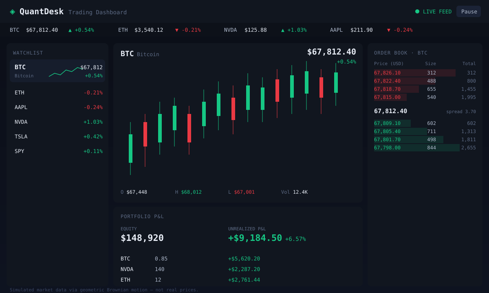

# QuantDesk — Real-Time Trading Dashboard

A high-frequency **markets / trading dashboard** built with **React + Vite + TypeScript**. It
streams a fully in-browser **simulated market-data feed** (a generator that mimics a websocket)
and renders it as live candlestick charts, a virtualized order book, a watchlist with sparklines,
a scrolling price ticker, and a mark-to-market P&L panel — all on a dark, fully responsive theme.

**No backend, no API keys, no real money.** Prices are generated locally with **geometric Brownian
motion (GBM)**, the standard log-normal model for asset price paths.

### ▶ Live demo

**https://maddoxk.github.io/frontend-trading-dashboard/**



> The image above is a hand-built SVG mock of the layout. The live link renders the real,
> animated dashboard (headless screenshotting is disabled in the build environment, so an SVG
> preview is committed instead of a PNG).

---

## Features

- **Simulated market feed** — a `MarketFeed` class advances a GBM price for every symbol on a
  fixed 250 ms interval, aggregates 1-second OHLC candles, and pushes ticks to subscribers exactly
  like a websocket (`subscribe` / `start` / `stop`).
- **Live candlestick chart** — powered by [`lightweight-charts`](https://github.com/tradingview/lightweight-charts);
  new candles are streamed via the efficient `series.update()` path rather than re-setting data.
- **Virtualized order book** — a synthetic bid/ask ladder rebuilt around the live mid price, with
  depth-bar backgrounds, cumulative totals, and a windowed (fixed-row) render so deep books stay
  cheap to paint.
- **Watchlist with sparklines** — six instruments (BTC, ETH, AAPL, NVDA, TSLA, SPY), each with a
  dependency-free inline-SVG sparkline of recent prices and click-to-select.
- **Scrolling price ticker** — a seamless CSS marquee of live prices and day-change.
- **Portfolio P&L** — a demo book of positions marked to market each tick, with per-position and
  aggregate unrealized P&L and percentage return (memoized).
- **Smooth high-frequency updates** — sampling, `useMemo`/`useCallback` memoization, and windowed
  rendering keep the UI fluid under a 4 Hz feed across six symbols.
- **Dark, responsive layout** — CSS-grid three-column desktop layout that collapses gracefully on
  smaller screens.

## Architecture

```
                       ┌──────────────────────────────┐
                       │  MarketFeed (lib/marketFeed)  │
                       │  • GBM price per symbol       │
   gbm.ts  ──────────▶ │  • 1s OHLC candle aggregation │
   (GBM + PRNG)        │  • subscribe / start / stop   │
                       └───────────────┬──────────────┘
                                       │ FeedTick (quotes + candles) @ 4 Hz
                                       ▼
                       ┌──────────────────────────────┐
                       │  useMarketFeed (React hook)   │
                       │  owns one feed, streams state │
                       └───────────────┬──────────────┘
                                       │ quotes / candles / running / toggle
        ┌──────────────┬───────────────┼───────────────┬──────────────┐
        ▼              ▼               ▼                ▼              ▼
    Ticker        Watchlist        PriceChart       OrderBook      PnLPanel
  (marquee)    (+ Sparkline)   (lightweight-charts) (virtualized)  (pnl.ts)
```

Pure, framework-agnostic logic lives in `src/lib/` (and is unit-tested with Vitest):

| Module | Responsibility |
| --- | --- |
| `lib/gbm.ts` | Seedable PRNG (mulberry32), Box–Muller normal, `gbmStep` / `gbmPath` |
| `lib/marketFeed.ts` | The websocket-like feed, symbol config, candle aggregation |
| `lib/orderbook.ts` | Synthetic depth ladder with cumulative totals |
| `lib/pnl.ts` | Mark-to-market portfolio P&L |
| `lib/format.ts` | Currency / percent / quantity / abbreviation formatting |

## Tech stack

React 18 · TypeScript 5.6 · Vite 5 · lightweight-charts 4 · Vitest 2 · CSS grid · GitHub Actions → GitHub Pages.

## Run locally

```bash
npm install
npm run dev          # http://localhost:5173/frontend-trading-dashboard/
npm run build        # type-check (tsc -b) + production build to ./dist
npm run preview      # serve the production build
npx vitest run       # run the unit tests (36 tests across 4 files)
```

> Requires Node 18+. The base path is set to `/frontend-trading-dashboard/` for GitHub Pages, so
> the dev/preview URLs include that prefix.

## Tests

36 Vitest unit tests cover the deterministic core:

- **GBM** — PRNG determinism, normal mean/variance, price positivity, zero-vol drift, path drift.
- **Order book** — depth, bid/ask ordering, non-negative spread, monotonic cumulative totals.
- **P&L** — per-position and aggregate unrealized P&L, percent return, missing-quote fallback.
- **Formatting** — currency, signed currency, percent, abbreviation, edge cases.

## Deployment

A GitHub Actions workflow (`.github/workflows/pages.yml`) builds the Vite app on Node 20 and
deploys `./dist` to GitHub Pages on every push to `main`. A `.nojekyll` file is included so Pages
serves the hashed asset filenames untouched.

## License

[MIT](./LICENSE) © 2026 Maddox Krape.

*Educational demo. All prices are simulated and do not represent real markets.*
